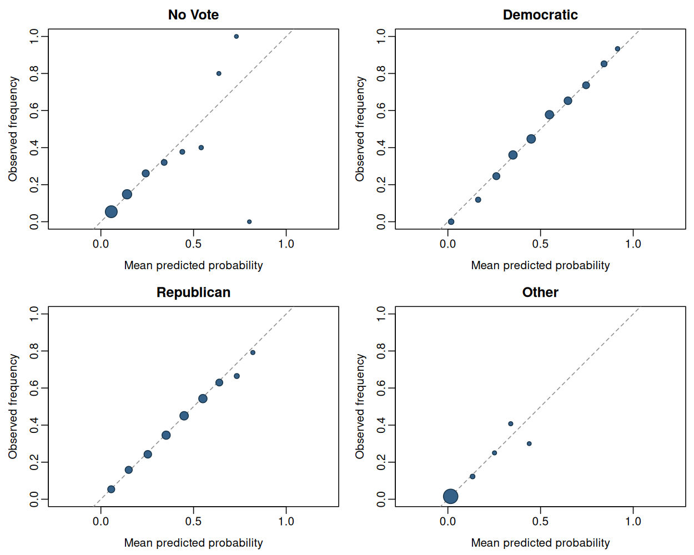
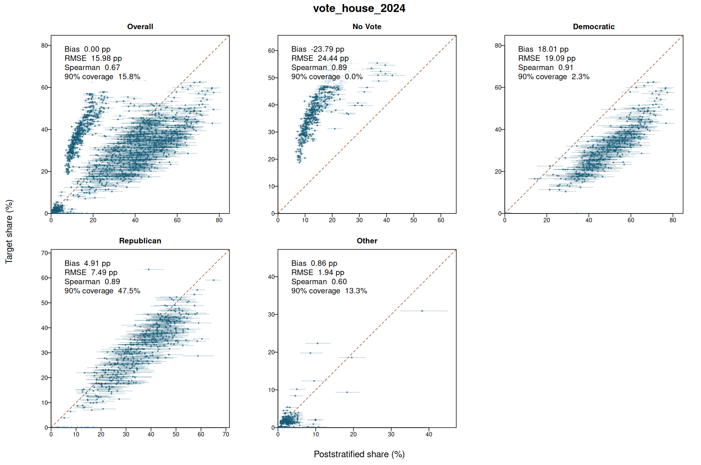
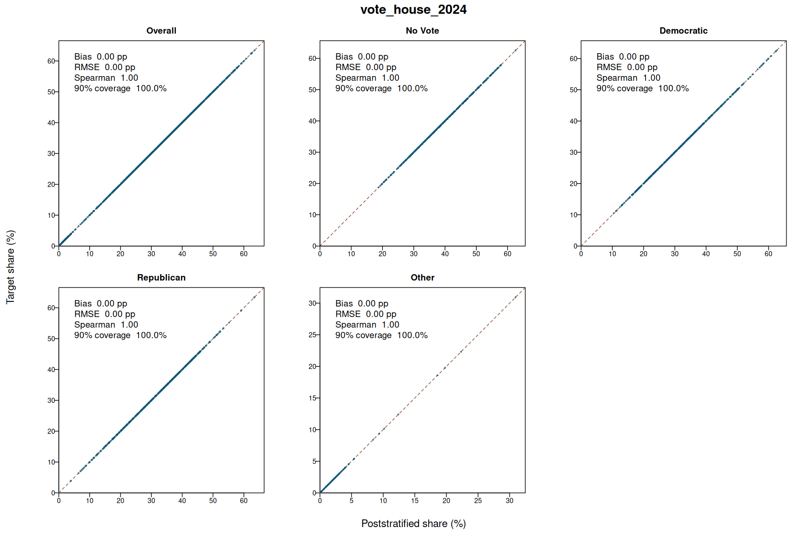
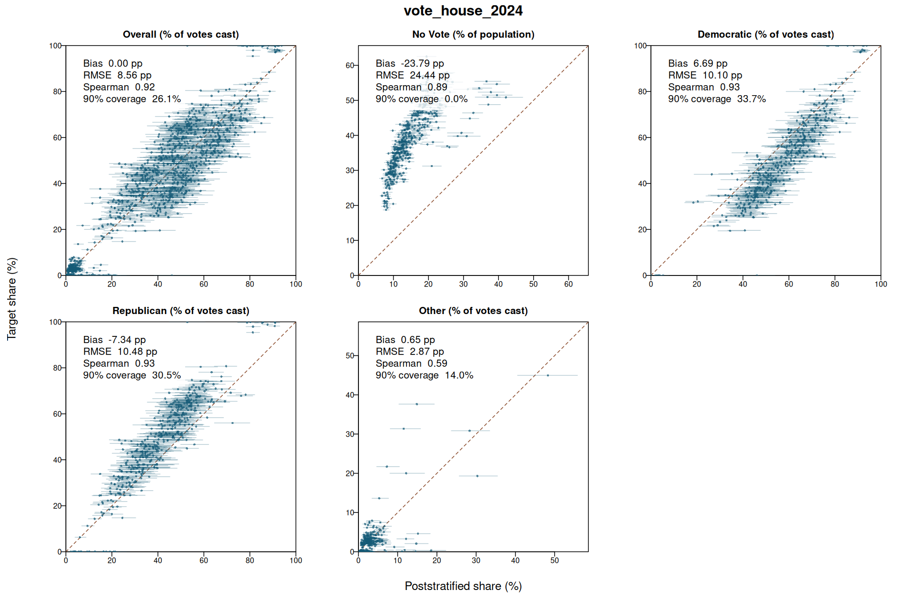
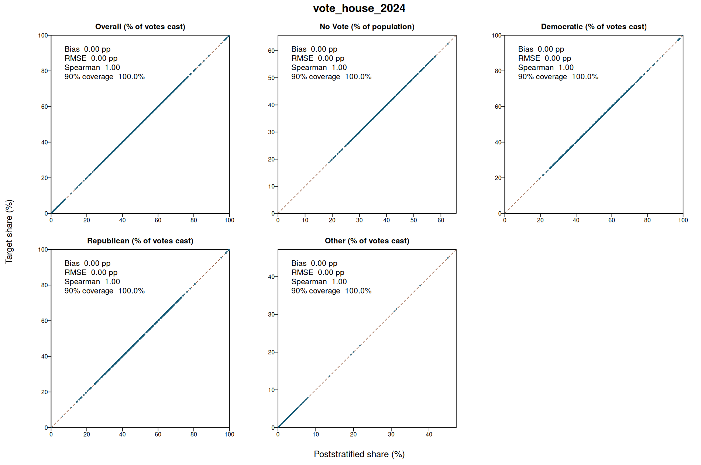
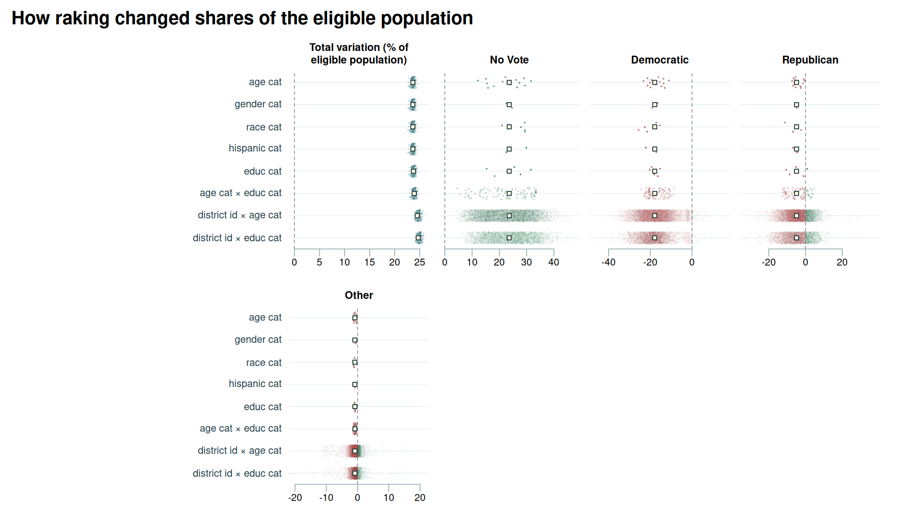

# Step 11. Extend the frame with 2024 House vote

Step 11 estimates 2024 House vote choice within each demographic cell on the
120th Congress district map (CD120). It calibrates the extension to district
House shares and preserves the Step 10 population joint. The resulting frame
is an input for later post-stratification. [Step 10 inputs](../../get_us_2024_xframe_data.md)

*Table 1. Step 11 inputs and frame dimensions.*

| Input or output | Unit | Rows |
| --- | --- | ---: |
| PUMS mother frame | District × demographic profile | 497,550 |
| CES handoff | Respondent | 58,627 |
| Eligible CES fit sample | Respondent with a recorded House choice and complete model predictors | 54,703 |
| Election inputs and House targets | District × choice | 1,744 |
| Pre-rake and raked frames | District × demographic profile × choice | 1,990,200 each |

The outcome $Y_i$ is the individual CES respondent's 2024 House choice.
The ordered categories are $0$ (No Vote), $D$ (Democratic), $R$ (Republican),
and $O$ (Other). No Vote means no counted House candidate vote on the
population scale. On CD120, Step 09 supplies recorded returns where available
and modeled shares for the applicable boundary or ballot scenarios. The
target CSV records the provenance of each district. [Construction of House shares](09_model_house_votes.md)

## Sequential model

Let $d(i)$ and $s(i)$ denote the district and state of respondent $i$. For
stage $k$ in the order $0,D,R$, let $\mathcal R_k$ contain the choices still
available. Each stage fits the conditional probability

*Equation 1. Conditional response probability and logit link for each stage.*

$$
p_{ik}=\Pr(Y_i=k\mid Y_i\in\mathcal R_k),
\qquad \mathrm{logit}(p_{ik})=\eta_{ik}.
$$

Let $\mathcal A$ contain race, gender, age, education, and Hispanic ethnicity.
The model treats race and Hispanic ethnicity as separate factors with the same
varying-intercept and interaction rules. Both are also keys in the original
population joint.

*Equation 2. Requested stage-specific predictor for individual House choice.*

$$
\begin{aligned}
\eta_{ik}={}&\alpha_k+
 f_{H,k}(H_{d(i),k})+f_{P,k}(P_{s(i),k})\\
 &+z_{d(i)}^\top\gamma_k+I_{d(i),k}\beta_k\\
 &+u^{(s)}_{k,s(i)}+u^{(d)}_{k,d(i)}
 +\sum_{a\in\mathcal A}u^{(a)}_{k,a(i)}
 +\sum_{\{a,b\}\subset\mathcal A}u^{(a,b)}_{k,a(i),b(i)} .
\end{aligned}
$$

- $H_{d,k}$ and $P_{s,k}$ are the 2024 district House and state presidential
  shares for stage $k$, both on the citizen-adult scale. The functions $f_{H,k}$
  and $f_{P,k}$ are penalized smooths with linear terms.
- $z_d$ gives the district lineup indicators with `D` as the reference.
  $I_{d,k}$ indicates party incumbency and enters the $D$ and $R$ stages.
  The No Vote stage omits the incumbency term.
- The $u$ terms are varying intercepts. The last sum is over the ten
  unordered pairs of distinct demographic predictors in $\mathcal A$.
  Geography and the area covariates enter as main effects.
- Individual vote history is excluded from the predictors.

The four predicted probabilities are

*Equation 3. Unconditional probabilities implied by the sequential logits.*

$$
\begin{aligned}
\pi_{i0}&=p_{i0},\\
\pi_{iD}&=(1-p_{i0})p_{iD},\\
\pi_{iR}&=(1-p_{i0})(1-p_{iD})p_{iR},\\
\pi_{iO}&=(1-p_{i0})(1-p_{iD})(1-p_{iR}).
\end{aligned}
$$

The workflow requests depth 2 for both fits, so depth 3 in the support plots
is a reference. The stage logs and formulas identify what was fitted.
Every fitted stage retained Hispanic ethnicity, all ten demographic crosses,
both share smooths, and all five lineup contrasts. Saved fit objects map
`.group_*` labels to their terms in `grouping_columns`.
[Step 11 source](../scripts/11_extend_frame.R)

## Frame counts and raking

Let $N_c$ be the Step 10 citizen-adult count in original cell $c$, including
its district and full demographic joint. For draw $m$, the initial extended
count is $E_{ck}^{(m)}=N_c\pi_{ck}^{(m)}$. The calibrated counts $X_{ck}^{(m)}$
satisfy both constraints separately for the mean and every draw:

*Equation 4. Original-cell and district-by-choice calibration constraints.*

$$
\begin{aligned}
\sum_k X_{ck}^{(m)} &= N_c &&\text{for each original cell }c,\\
\sum_{c:\,d(c)=d}X_{ck}^{(m)} &= H_{dk}\sum_{c:\,d(c)=d}N_c
&&\text{for each district }d\text{ and choice }k .
\end{aligned}
$$

One production `MasterP()` call fits the full CES sample, predicts, and rakes.
Prediction batches contain at most 4,000 population cells. Raking batches
keep up to four whole districts together. The public SynthFrame diagnostic
functions operate on district totals or state partitions. The script releases
the raked national frame before reading the pre-rake national frame for
diagnostics.

For counts $A_{dk}=\sum_{c:\,d(c)=d}X_{ck}$, the two district comparisons use

*Equation 5. District shares on the citizen-adult and counted-vote scales.*

$$
q_{dk}=\frac{A_{dk}}{\sum_j A_{dj}},\qquad
q_{dk\mid V}=\frac{A_{dk}}{\sum_{j\ne 0}A_{dj}}\quad(k\ne 0).
$$

The same ratios are applied to pre-rake counts and to the benchmark counts.
The conditional denominator is counted House votes. Ratios are formed
draw by draw before calculating the 90% intervals.

## Respondent holdout

Within each observed category $k$, the fixed-seed split holds out
$\lfloor 0.2 n_k\rfloor$ CES respondents. The training sample contains 43,763
respondents and the test sample contains 10,940. Scoring uses unweighted
posterior mean probabilities and the same area covariates as production.
The party-only comparison uses the 9,662 held-out voters, with probabilities
$\bar\pi_{ik}/(1-\bar\pi_{i0})$ for $k\ne 0$.

For $n$ scored respondents and scoring probabilities $\widehat p_{ik}$,
log loss and multiclass Brier score are

*Equation 6. Respondent log loss and multiclass Brier score.*

$$
L=-\frac{1}{n}\sum_i\log\!\left(\max(\widehat p_{i,Y_i},10^{-15})\right),
\qquad
B=\frac{1}{n}\sum_i\sum_k\left(\widehat p_{ik}-\mathbf 1\{Y_i=k\}\right)^2 .
$$

*Table 2. Overall respondent holdout scores on both scales.*

| Scoring set | Respondents | Accuracy | Log loss | Brier score |
| --- | ---: | ---: | ---: | ---: |
| All four choices | 10,940 | 58.46% | 0.9046 | 0.5275 |
| Party choice given reported turnout | 9,662 | 66.11% | 0.6582 | 0.4260 |

The two rows use different samples and outcome spaces. The calibration CSV
compares mean predicted probability with observed frequency within each
decile-width probability bin.

### Errors by observed choice

Recall is the fraction of respondents with observed choice $k$ whose
highest-probability prediction was $k$. Choice-specific log loss averages
$-\log(\widehat p_{ik})$ over respondents with $Y_i=k$, using the same floor
as the overall score. The Brier component averages
$(\widehat p_{ik}-\mathbf 1\{Y_i=k\})^2$ over the full scoring set, so it
includes false positives. The Brier components add to the multiclass score.

*Table 3. Respondent holdout scores by observed choice.*

| Scoring set | Observed choice | Respondents | Recall | Log loss | Brier component |
| --- | --- | ---: | ---: | ---: | ---: |
| All four choices | No Vote | 1,278 | 6.73% | 1.8776 | 0.0946 |
| All four choices | Democratic | 5,364 | 72.30% | 0.6308 | 0.2132 |
| All four choices | Republican | 4,099 | 59.19% | 0.8347 | 0.2027 |
| All four choices | Other | 199 | 3.02% | 3.4771 | 0.0170 |
| Conditional on turnout | Democratic | 5,364 | 72.93% | 0.5158 | 0.2035 |
| Conditional on turnout | Republican | 4,099 | 60.23% | 0.7153 | 0.2037 |
| Conditional on turnout | Other | 199 | 3.52% | 3.3226 | 0.0189 |

No Vote and Other were rarely the highest-probability predictions. Other
had the largest log loss among respondents who chose it. Its low prevalence
contributes to its small Brier component across the full scoring set.



*Figure 1. Respondent holdout calibration. Each point represents a nonempty probability
bin. Larger points represent more respondents. The dashed line marks exact
agreement.*

## District agreement and calibration checks

For the relevant district-choice pairs $\mathcal S$, let $e_{dk}$ be the
estimated share minus its benchmark under the chosen denominator. The pooled
error in percentage points is

*Equation 7. Pooled district RMSE and bias in percentage points.*

$$
\mathrm{RMSE}=100\sqrt{\frac{\sum_{(d,k)\in\mathcal S} e_{dk}^2}{|\mathcal S|}},
\qquad
\mathrm{Bias}=100\frac{\sum_{(d,k)\in\mathcal S}e_{dk}}{|\mathcal S|}.
$$

*Table 4. Pre-rake district bias and RMSE by choice and denominator.*

| Scale | Choice | Pre-rake bias (pp) | Pre-rake RMSE (pp) |
| --- | --- | ---: | ---: |
| Unconditional | Pooled | 0.00 | 15.98 |
| Unconditional | No Vote | −23.79 | 24.44 |
| Unconditional | Democratic | +18.01 | 19.09 |
| Unconditional | Republican | +4.91 | 7.49 |
| Unconditional | Other | +0.86 | 1.94 |
| Conditional on turnout | Pooled | 0.00 | 8.56 |
| Conditional on turnout | Democratic | +6.69 | 10.10 |
| Conditional on turnout | Republican | −7.34 | 10.48 |
| Conditional on turnout | Other | +0.65 | 2.87 |

Before raking, the largest systematic discrepancy was the underprediction of
No Vote. Among counted House votes, the raw extension overestimated Democratic
share and underestimated Republican share. The pooled biases are approximately
zero by construction when all choices are included. Pooled 90% benchmark
coverage rose from 15.77% unconditional and 26.07% conditional to 100% after
raking. Post-rake pooled RMSE was below $10^{-12}$ percentage points on both
scales. Post-rake agreement measures satisfaction of the constraints. The
respondent holdout measures predictive performance.

### Before and after raking



*Figure 2. Unconditional district agreement before raking. Points compare
district-choice means with benchmarks. Bars show 90% intervals.*



*Figure 3. Unconditional district agreement after raking. The pooled panel
includes No Vote.*



*Figure 4. Turnout-conditional district agreement before raking. The pooled
panel includes the three party choices.*



*Figure 5. Turnout-conditional district agreement after raking. The separate
No Vote panel retains the citizen-adult denominator.*

The run checks district share residuals to $2\times 10^{-12}$ and original-cell
count residuals to $10^{-8}$ people across the mean and every draw. The largest
absolute residuals were $1.66\times10^{-14}$ in district shares and
$7.28\times10^{-12}$ people in original-cell counts.

### Changes in unconstrained margins

No Vote rose by 31.60 points for ages 18–22 and by 31.55 points for the
no-high-school category. House shares by district are calibration constraints.
Figure 6 follows the SynthFrame US House vignette and shows national
demographic margins and district-by-age and district-by-education margins.
These subgroup shares describe how the district calibration redistributed
outcome counts. [SynthFrame US case study](https://github.com/AI-Pop-Up-Lab/synthframe/blob/main/vignettes/vignette_us_2026.md#13-measure-how-raking-changes-vote-shares)

For any displayed grouping, let $N_g$ be the citizen-adult count in subgroup
$g$ and let $\Delta q_{gk}$ be its after-minus-before share of outcome $k$.
The total variation in percentage points is

*Equation 8. Population-weighted total variation across subgroups.*

$$
\mathrm{TV}=50\sum_g\frac{N_g}{\sum_h N_h}\sum_k |\Delta q_{gk}|.
$$



*Figure 6. SynthFrame raking changes for 2024 House vote. In the outcome
panels, dots show signed subgroup changes in percentage points and squares
show their population-weighted means. In the total-variation panel, dots
show paired draws and squares show the comparison between mean-count frames.*

## Reproduce the run

From the repository root, run Step 10 and install SynthFrame 0.1.0 and its
dependencies in a library visible to R. [SynthFrame installation](https://github.com/AI-Pop-Up-Lab/synthframe#install-the-r-package)

*Snippet 1. Run Step 11 from the repository root.*

```bash
Rscript 01_frame/scripts/11_extend_frame.R
```

The default destination is `01_frame/data/output/11_frame_extension/`.
An optional first argument chooses a new output directory, and an optional
second argument sets the production draw count. The default and report use
125 draws. The seeds are `20241111` for validation and `20241112` for production.
A successful run writes `status.txt` containing `complete`. Allow several GiB
of storage and memory for national draws. See `session_info.txt` for the R
and package versions used.
The verified run used `R_GC_MEM_GROW=0` and set `OPENBLAS_NUM_THREADS` and
`OMP_NUM_THREADS` to one.

*Table 5. Files written by Step 11.*

| Output | Scope |
| --- | --- |
| `pre_rake/extended_frame.rds` | National mean and draw counts before raking |
| `raked_frame/<state_fips>.rds` | One calibrated partition per state and DC, with `N` and `N_draw_1` through `N_draw_125` |
| `production_fit.rds`, `validation_fit.rds` | Fitted stage objects |
| `diagnostics/*_fit.csv`, `*_formulas.csv`, `*_interaction_support.csv`, `*_depth_support/`, `masterp.log` | Stage fits, screening, support, and run trace |
| `diagnostics/respondent_*.csv` | Split, predictions, overall and choice-level scores on both scales, and respondent calibration |
| `diagnostics/district_*` | Target provenance and before/after plots, comparisons, and metrics for both denominators |
| `diagnostics/target_residuals.csv`, `original_joint*.csv`, `raking_changes*` | District target checks, original-cell checks, and changes in mean shares |

The release archives retain repository-relative paths. Extract the archives
from the repository root to restore the two frames. The release manifest
lists the archive, path, size, and SHA-256 digest for each member.
[Download the 125-draw frame release](https://github.com/robertocerinaprojects/polling-without-people/releases/tag/frame-extension-cd120-2026-11-27-v2)
